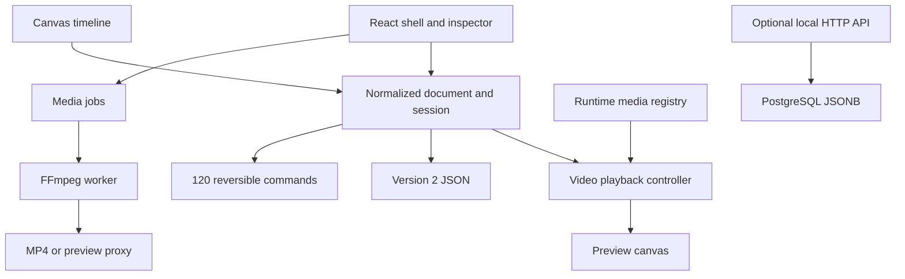

# TrimCut Studio

A local video editor built with React 18, strict TypeScript, Zustand, Canvas, and FFmpeg.wasm. Phase 2 adds a normalized multi-track document and reversible commands on top of the Phase 1 workspace and original icons. See [Phase 2 review](docs/phase-2-review.md) for behavior, validation, and the manual checklist.

## Run

Use Node **22.18+** (or 24/26) and npm. Node's built-in TypeScript stripping runs the model tests and the server's shared model import.

```sh
npm ci
npm run dev
```

Open http://127.0.0.1:5173. `predev` copies the locally installed FFmpeg core into `public/ffmpeg/`; no runtime CDN is used.

```sh
npm test
npm run typecheck
npm run build
npm run desktop
```

Desktop requires the Vite server running on **5173**. It is a development shell, not a packaged production app. `build` runs type checking, prepares FFmpeg, and writes `dist/`. To inspect a production build, run `npx vite preview`. Deployment must serve the WASM file with the correct MIME type; subpath hosting requires Vite's base configuration and matching route handling. `/icons` is designed for root hosting.

## Implemented in Phase 2

- Normalized tracks/clips/assets, separate runtime media registry, explicit placement on a 30fps grid.
- Multi-track video/audio editing, magnetic snapping, selected/group moves and trims, split, delete and global ripple delete.
- 120-step undo/redo; one command per drag; Escape cancels.
- Multi-selection, linking, copy/paste/duplicate, markers, lock/visibility, track addition, keyboard-accessible placement.
- Version 2 JSON metadata download; optional API validates legacy and current schemas.
- Preview selects the top visible video and shows black gaps. Independent audio mixing and layered compositing remain Phase 3; thumbnails/waveforms also remain Phase 3.
- MP4 export explicitly rejects gaps, overlaps, hidden clips and separate audio until composited export is implemented in Phase 5.

## Workspace features from Phase 1

- Token-based dark theme; cyan/teal accent; project name and JSON save.
- Full library tab rail and contextual inspector. Advanced editing actions awaiting later phases are labeled and disabled.
- Mouse/touch and keyboard panel resizing, remembered in localStorage; double-click a divider to reset it.
- Working video import, search, source-range editing, split, explicit clip placement, play/pause, frame stepping, and scrubbing.
- Timeline zoom and horizontal scrolling; playback keeps its playhead visible.
- Preview fit/50%/100%, fullscreen, and 16:9 / 9:16 / 1:1 / 4:5 project ratios. The selected ratio applies to MP4 export.
- Aspect-preserving preview proxies; exports always read original media.
- **59 original SVG icons**, separate components in `src/components/icons/`, typed `Icon` wrapper, `index.ts` barrel. No copied editor assets or icon library.
- `/icons` shows every icon at 16/20/24/32px in dark and light themes, with default/active/disabled examples and interactive hover/focus states.
- A modal lists current keyboard navigation and clearly identifies future editing shortcuts.

The main workspace is desktop-first (minimum 1010px, wider with expanded panels). Smaller windows can scroll; a compact mobile editor is not implemented.

## Architecture



- `src/types.ts`, `model.ts`: typed clip ranges, time mapping, trim/split math, timecode, serialization.
- `src/store.ts`: normalized document, session, runtime registry, and transactional edit actions.
- `src/editor/`: document types, placement/snapping math, editing operations, reversible commands, validation, and preview/export adapters.
- `src/components/layout/`: header, tabs, media panel, resize handles.
- `src/hooks/usePanelSizes.ts`: bounded local layout preferences.
- `src/components/preview/`, `hooks/useVideoPreview.ts`: video decoding, frame drawing, transport.
- `src/components/timeline/`, `timeline/`, `hooks/useTimelinePointer.ts`: visible viewport drawing and pointer editing.
- `src/components/inspector/`: selected-clip properties.
- `src/media/`, `hooks/useMediaJobs.ts`: import/export/proxy jobs and UI status.
- `src/components/icons/`, `pages/IconsPage.tsx`: original icon system and gallery.

The browser video element decodes frames and plays audio; Canvas fits those frames into the selected aspect. FFmpeg does not encode during normal playback or scrubbing. Preview still uses the MVP's single-video architecture; an overlap-aware compositor, independent audio clock/mixer, and WebCodecs support are later phases.

## Editing and export

Import or drop browser-decodable video. Click a clip to inspect it; drag its edges to trim or drag the body to move in time or between compatible tracks. Use the ruler to scrub. In/out fields commit on blur or Enter. Split uses the current playhead.

MP4 export is H.264, 30fps, stereo 48kHz AAC. Silent sources receive silence. Each segment is normalized and the parts are concatenated. Output sizes: 1920×1080, 1080×1920, 1080×1080, or 864×1080. Processing is local and can be slow for long media. Progress currently describes each encoding stage, not the entire job. Cancellation, custom resolution/fps/bitrate, WebM/GIF and 4K remain future work.

The installed FFmpeg core can return `-1` on successful ffprobe operations. The wrapper verifies fresh output JSON and the presence of a video stream instead of rejecting that return code alone. Encode and concat exit codes are still checked.

## Optional PostgreSQL API

Create a database, apply `server/schema.sql`, and set `DATABASE_URL` before running `npm run server`. GET/PUT `/api/projects/:uuid` persists the project document. This localhost-only API has no authentication and is not connected to the UI. The editor downloads schemaVersion 2 JSON metadata; media embedding/relinking, project loading, migrations, and IndexedDB autosave are not implemented yet. Project and media state are lost on refresh; only panel sizes persist.

## Verification

Strict TypeScript, Vite production build, and 26 tests pass. Model and store tests cover snapping, placement, trim/split, ripple, linked edits, clipboard, history transactions, JSON references and export guards. Browser smoke checks confirmed imports, track undo, delete/duplicate, Inspector cross-track placement, markers, and playback with original generated test media. Pointer-drag edge cases, full browser export, Electron, and long-project performance still need manual checks. See `docs/phase-2-review.md`.

## Dependencies and assets

| Dependency | License | Use |
|---|---|---|
| React / React DOM | MIT | UI |
| Zustand | MIT | State |
| Vite | MIT | Dev server/build |
| TypeScript | Apache-2.0 | Strict type checking |
| React / React DOM / prop-types / Node type definitions | MIT | Development types |
| Electron | MIT | Desktop development shell |
| Express / pg | MIT | Optional persistence API |
| @ffmpeg/ffmpeg / @ffmpeg/util | MIT | Worker wrapper/utilities |
| @ffmpeg/core 0.12.10 | GPL-2.0-or-later | Compiled media engine |

FFmpeg core and bundled codecs have separate licensing from the MIT wrapper. Retaining this dependency does not establish compatibility with every future distribution model; the export/distribution phase must resolve that choice. No additional runtime library was introduced in Phase 1. Icons are original code; no third-party demo media is included.
